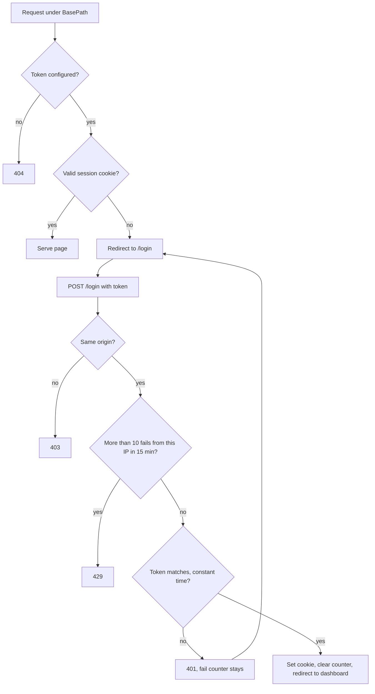
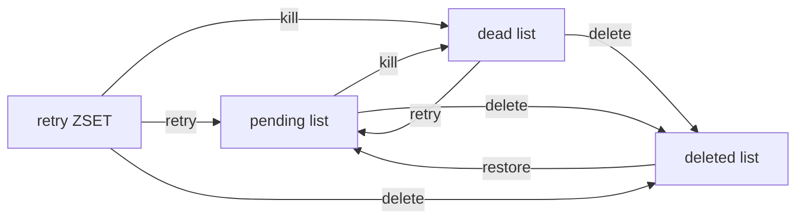
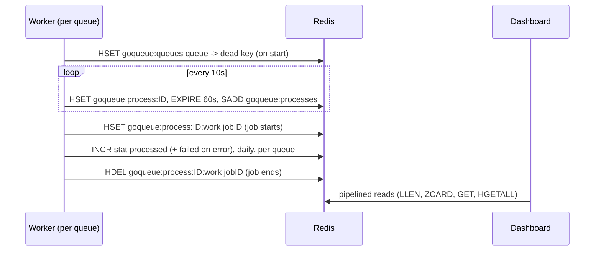

# goqueue Dashboard

**TL;DR:** a login-protected web UI for your Redis queues. Mount one `http.Handler`, set a 32+ byte token, open the path. See totals, retries, dead and busy jobs. Retry, kill, delete or restore them. Nothing is ever hard-deleted.

## Quick start

```bash
openssl rand -hex 32   # your token, at least 32 bytes
```

```go
h, err := dashboard.New(dashboard.Options{
    BasePath:    "/goqueue-ui",
    AccessToken: os.Getenv("GO_QUEUE_ACCESS_TOKEN"),
    Redis:       redisClient,
})
```

Mount examples (net/http and gin) are in the [README](../README.md#dashboard). Runnable demo: `cd examples && go run ./dashboard`.

## Options

| Option | Default | Notes |
|---|---|---|
| `BasePath` | required | Starts with one `/`; no spaces, backslash or braces. Trailing `/` trimmed. |
| `AccessToken` | none | Empty = every path 404. Under 32 bytes = `New` returns an error. |
| `Redis` | required with a token | Any `redis.UniversalClient`. |
| `SessionTTL` | 12h | Cookie lifetime. |
| `PollInterval` | 3s | Stats refresh in the browser. |
| `ClientIP` | host of `RemoteAddr` | Used only for the login throttle and the audit line. |
| `Logger` | no-op | `func(msg string, kv ...any)`. |

## Flow 1: access and login



- Cookie is `expiry.HMAC-SHA256(token, expiry)`. Stateless. Rotate the token and everyone is logged out.
- Redis down during login = 503 (fail closed).

## Flow 2: where jobs move



| Action | From | To |
|---|---|---|
| Retry | retry, dead | pending (run now) |
| Kill | pending, retry | dead |
| Delete | pending, retry, dead | deleted (kept, not erased) |
| Restore | deleted | pending |

- Each job is one atomic Lua move: never in two places, never lost.
- Up to 100 IDs per click. IDs already gone come back as "not found".
- Kill and "dead" need a Redis dead list for the queue; queues without one get a 400.
- Dead and deleted lists keep 1000 entries and expire 30 days after the last push.

## Flow 3: how worker tracking writes keys



A tracking write that fails is logged and never fails the job.

## Redis keys

| Key | Type | Content | Retention |
|---|---|---|---|
| `goqueue:queues` | HASH | queue -> dead list key ("" = none) | none |
| `goqueue:stat:processed`, `goqueue:stat:failed` | STRING | all-time totals | none |
| `goqueue:stat:<kind>:<YYYY-MM-DD>` | STRING | daily totals (UTC) | 180 days |
| `goqueue:stat:<queue>:<kind>` | STRING | per-queue totals | none |
| `goqueue:processes` | SET | process IDs | pruned when the hash is gone |
| `goqueue:process:<id>` | HASH | host, pid, queues, started_at, concurrency | 60s, refreshed every 10s |
| `goqueue:process:<id>:work` | HASH | jobID -> queue, job_name, started_at | 60s, entry removed on finish |
| `goqueue:deleted:<queue>` | LIST | deleted jobs | 1000 entries, 30 days |
| `<queue>` | LIST | pending jobs | n/a |
| `retry:<queue>` | ZSET | scheduled and retrying jobs | n/a |
| `job_index:<queue>` | HASH | job index, kept in step by actions | n/a |
| `goqueue:ui:login_fail:<ip>` | STRING | failed login count | 15 min |

Names live in `adapter/redis/keys.go`.

## Security notes

- **CSP:** `default-src 'self'` plus `frame-ancestors 'none'`, `form-action 'self'`, `object-src 'none'`, `base-uri 'none'`. No CDN, no inline script.
- **Other headers:** `X-Frame-Options: DENY`, `X-Content-Type-Options: nosniff`, `Cache-Control: no-store`, `Referrer-Policy: same-origin`.
- **Cookie:** `HttpOnly`, `Secure`, `SameSite=Strict`, `Path=BasePath`. Serve over HTTPS.
- **CSRF:** login, logout and actions require `Origin` (or `Referer`) host to equal the request `Host`. A proxy that rewrites `Host` breaks this: forward `$host` in nginx.
- **Throttle:** 10 failed logins per IP per 15 min, then 429. IPv6 is grouped by /64.
- **Audit log line** (only if you set `Logger`): `dashboard action` with `action`, `queue` (quoted), `source`, `done`, `not_found`, `ip`. Counts only, never job IDs or payloads. The token is never logged.

## Known limits

- **Redis Cluster:** the move script touches several keys that hash to different slots, so it fails with CROSSSLOT. Use a single Redis (or Sentinel).
- **Heartbeat rows are per queue**, not per OS process. A process running 3 queues shows 3 rows (`host:pid:queue`).
- **Stats count every attempt** (Sidekiq semantics): processed +1 per attempt, failed +1 per failed attempt. A job retried 3 times counts 4 processed.
- **Redis only:** memory, SQS and SQL drivers write no tracking keys.
- A worker with no heartbeat for 60s is treated as gone.
